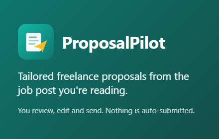
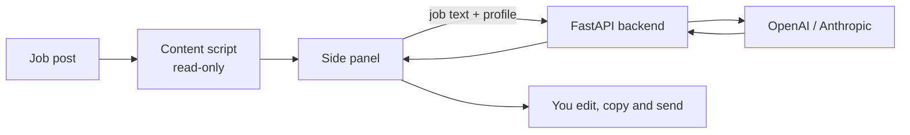

# ProposalPilot

[](https://github.com/shayan9689/Browser-extension-for-freelancers/actions/workflows/ci.yml)
[](LICENSE)

A Chrome extension that reads the freelance job post you are viewing and drafts a tailored proposal, with a suggested price and delivery estimate. You review, edit and send it yourself. ProposalPilot never clicks, types or submits anything on a marketplace.

<p align="center">
  
</p>

> **Status:** v1.0.0 code complete, store submission in progress. Try the
> [demo job post](https://shayan9689.github.io/Browser-extension-for-freelancers/demo/job-post.html)
> or read the [privacy policy](https://shayan9689.github.io/Browser-extension-for-freelancers/privacy-policy.html).

## Features

- **Side panel UI** that stays open while you read the job: detect → generate → edit → copy
- **Job extraction** with per-site adapters and a "use selected text" fallback for any page
- **Profile-grounded drafts:** the AI only uses facts from the profile you save
- **Local-first:** profile and the last 50 proposals stay in `chrome.storage.local`, with export and delete
- **Hardened backend:** FastAPI holds the LLM key, with prompt-injection defence, per-user and per-IP rate limits, a global daily cost cap and optional Redis
- **Minimal permissions:** `storage`, `sidePanel`, `activeTab`, `scripting`, no broad host access

## How it works



The extension never contains an API key. Everything shipped inside an extension is public, so the key lives only on the backend.

## Project layout

| Path | What |
|------|------|
| [`extension/`](extension) | WXT + React + TypeScript + Tailwind, Manifest V3 |
| [`backend/`](backend) | FastAPI (Python 3.12), Docker, Render config |
| [`docs/`](docs) | Privacy policy, store listing, deploy guide, runbook, incident playbook (served on GitHub Pages) |
| [`PRD.md`](PRD.md) | Product requirements |

## Development

**Backend** (uses a fake LLM provider by default, so no key is needed):

```bash
cd backend
pip install -r requirements-dev.txt
cp .env.example .env
uvicorn app.main:app --reload        # http://localhost:8000/health
```

**Extension:**

```bash
cd extension
npm install
npm run dev                          # opens Chrome with the extension loaded
```

Dev builds call `http://localhost:8000`. Production builds require an HTTPS URL:

```bash
VITE_API_BASE_URL=https://your-api.example.com npm run zip
npm run verify-zip                   # manifest at root, no localhost, no extra permissions
```

## Tests

```bash
cd extension && npm run lint && npm run typecheck && npm test && npm run check:fixtures
cd backend && ruff check . && pytest -q
```

CI runs all of the above on every push. Pushing a `vX.Y.Z` tag builds, verifies and attaches the store zip to a GitHub Release (see [`release.yml`](.github/workflows/release.yml)).

## Adding or fixing a site adapter

1. Save a sample page (personal data removed) under `extension/tests/fixtures/`.
2. Update selectors in `extension/src/content/adapters/selectors.ts`.
3. Run `npm run check:fixtures` and `npm test`.

See [CONTRIBUTING.md](CONTRIBUTING.md) for details.

## Deployment and operations

- [Deploy the backend](docs/deploy.md): environment variables, Redis, proxy notes
- [Launch checklist](docs/launch-checklist.md): production test and Chrome Web Store submission
- [Runbook](docs/runbook.md) and [incident playbook](docs/incident-playbook.md)

## Privacy

Job text and your profile are sent only when you click **Generate**. They are not stored or logged on the server. History stays on your device. Full details: [privacy policy](docs/privacy-policy.md).

## Roadmap

- Chrome Web Store release
- Bring-your-own-key mode
- Microsoft Edge Add-ons

## License

[MIT](LICENSE)
