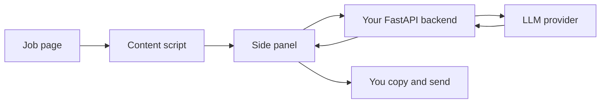

# ProposalPilot

Chrome extension that reads the freelance job post you are viewing and drafts a tailored proposal with a suggested price and delivery estimate. **You always review, edit, and send manually.**


**Status:** v1.0.0 local build complete (phases 0–12 scaffolded). Production publish steps are manual — see below.

## Features

- Side panel UI (idle ? detect ? generate ? edit/copy)
- Fiverr / Upwork adapters + selected-text fallback
- Local profile, history (50), export/delete
- Self-hosted FastAPI backend (Fake / Anthropic / OpenAI)
- Rate limiting, daily cap, privacy-minded logging

## How it works



## Privacy

Job text and profile are sent only when you generate a proposal. They are not stored or logged on the server. History stays on-device. See `docs/privacy-policy.md`.

## Development setup

### Extension

```bash
cd extension
npm install
npm run dev
# Load unpacked: chrome://extensions ? extension/.output/chrome-mv3 (after build)
npm run build
```

Set `VITE_API_BASE_URL` (see `extension/.env.development`).

### Backend (system Python — no venv required)

```bash
cd backend
pip install -r requirements-dev.txt
copy .env.example .env
uvicorn app.main:app --reload
```

## Tests

```bash
cd extension && npm run lint && npm run typecheck && npm run test && npm run check:fixtures && npm run test:e2e
cd backend && ruff check . && pytest -q
```

## Add / fix a site adapter

1. Save HTML fixtures under `extension/tests/fixtures/`.
2. Update selectors in `src/content/adapters/selectors.ts`.
3. Run `npm run check:fixtures`.

## Roadmap

- Real Chrome Web Store listing
- Optional bring-your-own-key mode
- Microsoft Edge Add-ons package

## License

MIT
